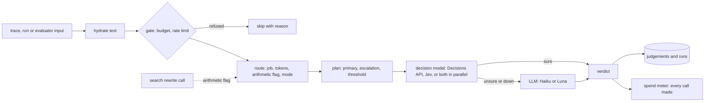

# LangWatch Judge router (reference implementation)

A small Python package that picks the model, or models, for one yes/no judgement. It is the reference for porting the
router into `modules/instant-eval-judge` in TypeScript. It is not deployed from here.

## The port in short

- The router becomes TypeScript inside `modules/instant-eval-judge`, where every Instant Evals judgement already runs
  through `InstantEvalJudgeService` and the hosted channels, limiter, pricing and spend live.
- The module keeps zero peers: callers resolve the mode and the arithmetic flag and pass them in, the same way the
  decision model is passed today (proposed through `ModelProviderApi.resolveDecisionModel`).
- The route table structure becomes a Zod schema in the contract; `validate()` in `config.py` becomes its refinements.
- `route()` and `unsure()` become pure rules; `run()` becomes a router service over the existing channels.
- Escalation legs (Claude Haiku, gpt-6-luna) become new leaf channels on LangWatch's keys; Jev and the Decisions API
  reuse the existing classifier and decision model channels.
- The real route table and per-model pricing are deploy-time configuration. The committed default sends every slot to
  hosted Jev with no escalation, which is today's behaviour, so the change is a no-op when the router is off.
- It ships behind an organization-scoped feature flag, off by default, cloud only. Metering stays check, classify,
  record: the price is the sum of every call made, one spend row per request.
- Only yes/no questions are routed. Score and category questions, own decision models and the search bar's route
  classification keep today's path.

## Where it plugs in

It replaces the single decision model call in the Instant Evals judge flow. The gate, metering and storage stay put.



## Inputs

- `job`: `search`, `llm_judge` or `scenario_judge`.
- `tokens`: the token count of the full input. When missing it is estimated from the byte length.
- `arithmetic`: true when the question needs counting or arithmetic. For search the caller passes it (the search
  rewrite call can return it); otherwise a regex over the question decides (`features.py`).
- `mode`: `instant`, `balanced` or `accurate`. Missing means the job's default (`balanced`).

The table is looked up by job, then length bucket (up to 2k, 2k to 8k, 8k to 32k, over 32k), or the arithmetic slot
for short inputs with the flag set.

## Modes

- `instant`: decision models only. One model, or the Decisions API and Jev in parallel as a confident pair, keeping
  the answer with the larger |2p - 1| (a tie goes to the primary).
- `balanced`: a decision model first; unsure checks go to an LLM. Some slots use one LLM call instead.
- `accurate`: the best enabled option for the slot.

A mode with no enabled entry falls back to the next cheaper one (accurate, then balanced, then instant). The plan
records both the mode asked for and the mode used.

## Escalation

Escalate when |2p - 1| < threshold, where p is the decision model's probability of yes. A threshold of 0.7 means
escalate when 0.15 < p < 0.85. A missing p, or no verdict, always escalates.

## Fallbacks

- A backend that is down, timed out or out of capacity is replaced by its configured fallbacks (Vega and Nox fall
  back to the Decisions API).
- Primary down with an escalation planned: the escalation model answers (flag `primary_failed`).
- Escalation down or timed out: the primary's verdict is kept (flag `escalation_failed`).
- Confident pair with one leg down: the other leg answers. A pair never calls the same model twice.
- Nothing answered: no verdict, and a skip reason using the platform's names (`classifier_provider_unavailable`,
  `classifier_rate_limited`, `classifier_key_invalid`, ...). No client retries on its own.

## Backends

| Backend | Request | Probability |
|---|---|---|
| Decisions API | `POST /v1/decisions` with one `predicate` question | the predicate's probability of yes |
| Jev | `POST /v1/systemone` with `{state, model, questions: {q: {type: noul}}}`, as the platform sends it | `answers.q.noul` |
| Claude Haiku | Messages API, the strict langevals `llm_boolean` request with a forced `evaluation` tool | none (verdict only) |
| gpt-6-luna | Responses API, the same request | none (verdict only) |
| Vega, Nox | OpenAI-compatible completions on a vLLM server | yes/no logprobs |

Keys come from `OPENAI_API_KEY`, `TYPESAFE_API_KEY` and `ANTHROPIC_API_KEY`. Any object with
`judge(call, timeout_s) -> Answer` can stand in for a client, so the platform's own channels can be wrapped.

## Use

```python
from judge_router import Request, default_clients, load, route, run

table = load()                    # routes.yaml
plan = route(Request(job="search", text=text, question=q, tokens=n, arithmetic=flag), table)   # pure, no I/O
result = run(Request(job="search", text=text, question=q, tokens=n, arithmetic=flag), default_clients(table), table)
```

`routes.yaml` holds routing only. An optional `routes.metrics.yaml` beside it (kept out of the repo, see
`.gitignore`) adds per-entry metrics; with it, entries over the cost cap in `max_usd_per_1k` are disabled.
`load(overrides={"vega": True})` turns a GPU backend on once it is served.

## Tests

```bash
cd services/judge-router
uv run --python 3.12 --with pyyaml --with pytest python -m pytest -q
```

Tests use fake clients and a stubbed transport; any network call fails the test. Tests that read benchmark numbers
skip when the metrics overlay or the replay rows are not present.

## Out of scope

- GPU backends (Vega, Nox) are wired and tested with fakes, but off.
- The scenario judge lives in the scenario repo; the built-in scenario prompt here is a boolean stand-in.
- Score and category questions: only yes/no questions are routed.
- Text fitting is a simple keep-both-ends cut; the platform's own fitting should replace it.
- Self-hosted installs, guardrails and caching.
